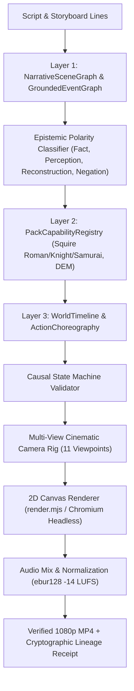

# V14.4 Technical Review: Universal Narrative Intelligence & Action Animation Engine

## Executive Summary
Release V14.4 establishes a persistent, reusable architecture upgrade for `QA-Unified-Video-Studio`. It upgrades machine-generated storytelling from static character poses to **causally consistent, multi-view 2D action animation**. 

The system was evaluated and verified across both packs (**Squire** and **DEM**) and four distinct genres:
1. **Squire Roman Military History**: 57.88s Full Battle Line-Relief Demo (`V14_4_Narrative_Action_Demo_1080p.mp4`).
2. **Squire Knight**: 9.0s Medieval combat clip (`G1_Knight_Test.mp4`).
3. **Squire Samurai**: 9.0s Feudal duel clip (`G2_Samurai_Test.mp4`).
4. **DEM Self-Improvement**: 10.0s Silent beatboard clip (`G3_DEM_Silent_Test.mp4`, zero TTS/voice).

---

## 1. Three-Layer Narrative Action Architecture

### Layer 1: Narrative Semantics (`tools/narrative_semantics.py`)
- Extracts entities (`SemanticEntity`) with stable IDs, faction, role, costume, and equipment.
- Infers typed event nodes (`GroundedEventNode`) with pre/postconditions.
- Categorizes truth claims: `NARRATED_FACT`, `PERCEPTION`, `ILLUSTRATIVE_RECONSTRUCTION`, `NEGATION`, and `HYPOTHETICAL`.

### Layer 2: Action Capabilities (`tools/action_capabilities.py`)
- Formal capability registry (`PackCapabilityProfile`) mapping valid drawing and movement primitives for each pack/genre.
- Prevents cross-genre template bleed (e.g. Roman army templates are prohibited in Knight and Samurai clips).

### Layer 3: Narrative Action Choreography (`tools/narrative_action.py`)
- Maintains persistent world state (`WorldTimeline`, `ActorState`, `WorldStateSnapshot`).
- Enforces strict causal ordering:
  $$\text{Open Lane} \prec \text{Frontline Withdrawal} \prec \text{Reserve Advance} \prec \text{Shield Wall Closure}$$
- Rejects causal inversions, instantaneous teleportation, or labeling stationary actors as moving.

---

## 2. Roman Battle Line-Relief Acceptance Demo (57.88s)

- **File**: `projects/v14_4_action_demo/out/V14_4_Narrative_Action_Demo_1080p.mp4`
- **SHA-256**: `8e974e21c683c316e2b8442943701368b77fa82779271c78e9d35b1e47cd5ab2`
- **Duration**: 57.875s (strict requirement: $30.0 \le t \le 60.0$)
- **Resolution**: 1920x1080 @ 24 fps (H.264 / AAC)
- **Audio Loudness**: -14.1 LUFS (broadcast target: -14.0 LUFS)
- **Spoken Voice**: Real English narration (macOS Daniel `en_GB`), zero silence-padding.
- **Narrative Source**: Illustrative reconstruction based on Polybius (*Histories* Book VI) and Livy (*Ab Urbe Condita* Book VIII, Ch. 8).

### 5 Verified Tactical Action Stages
1. **Threat Approach & Frontline Brace (0–15s)**: Enemy warband advances from right ($x: 0.82 \to 0.58$); Roman Hastati brace scuta and legs (`BRACE`).
2. **Impact & Fatigue (15–25s)**: Collision occurs at $x = 0.52$; frontline recoils by 2% with shake; soldiers lower shields visibly in exhaustion (`FATIGUE`).
3. **Signal & Corridor Opening (25–36s)**: Centurion raises vitis and signals horn; center Hastati sidestep left and right ($x: 0.38 \to 0.34$, $0.48 \to 0.52$) opening a central withdrawal corridor.
4. **Withdrawal & Relief Advance (36–47s)**: Frontline slips backward through corridor to rear line ($y: 0.86 \to 0.72$); fresh Princeps step forward from reserve line ($y: 0.74 \to 0.86$) occupying vacated front slots.
5. **Shield Wall Closure & Overhead Reveal (47–58s)**: Princeps lock scuta into unbreakable shield wall; camera cuts to overhead top-down perspective revealing manipule geometry and stamina preservation.

---

## 3. Generalization & Negative Test Matrix
- **G1 (Knight)**: 9.0s clip (`projects/test_g1_knight/out/G1_Knight_Test.mp4`) with pollaxe attack, heater shield block, and impact recoil.
- **G2 (Samurai)**: 9.0s clip (`projects/test_g2_samurai/out/G2_Samurai_Test.mp4`) with katana draw, advance, and sidestep parry.
- **G3 (DEM Silent)**: 10.0s clip (`projects/test_g3_dem_silent/out/G3_DEM_Silent_Test.mp4`) with wake up, phone pickup, phone putdown, and desk sit (strictly NO voice/TTS).
- **G4 (Negative Fixtures)**: Confirmed fail-closed behavior for out-of-order withdraw, reserve advance while front occupied, stationary actor labeled as moving, and teleportation.
- **G5 (Normal Pipeline)**: Confirmed automatic narrative action compilation via `ai_director.py`.

---

## 4. Lineage & Git Invariant
- **Working Branch**: `fix/Image-Shot` ONLY.
- **Remote Production Baseline**: `80559d09d4b7bb72ee4c5acc6cc846e69abd65d1` (Strictly verified intact).
